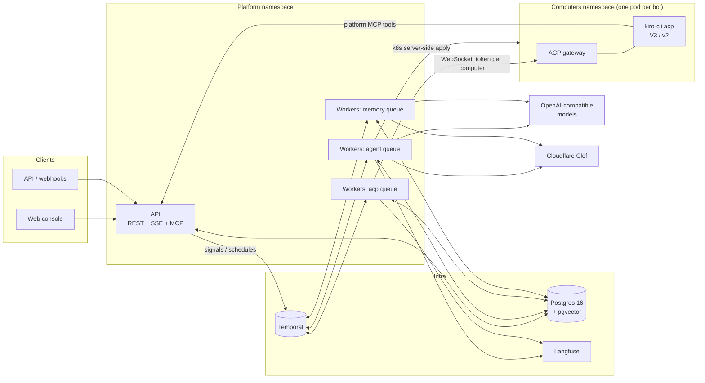
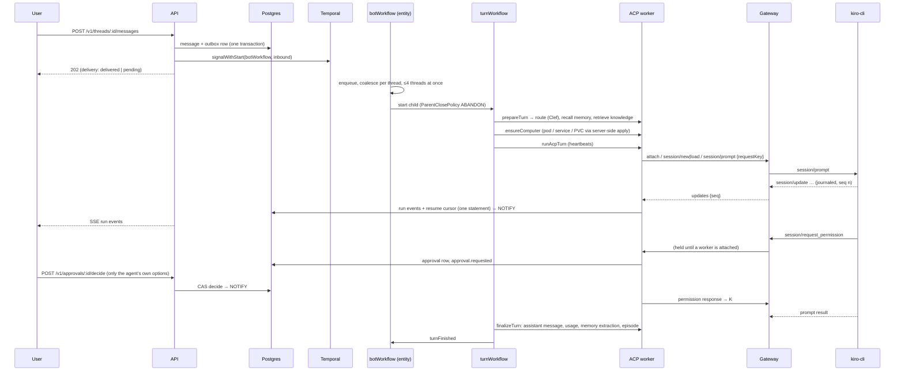

# Architecture

Orrery runs always-on AI teammates ("bots"). Each bot has standing instructions, its own sandboxed computer, layered memory, knowledge bases, tools governed by an approval policy, and a durable work queue. People talk to bots in the console, through the API, through webhooks and on schedules. Bots can also hand work to each other.

## Components

| Component | Responsibility |
| --- | --- |
| `apps/api` | REST + SSE API with OIDC/RBAC, OpenAPI 3.1, inbound webhooks, and the platform MCP server that agents call for memory, knowledge and delegation. A transactional outbox delivers inbound messages to Temporal. |
| `apps/worker` | Temporal workers. There are three roles, selected with `WORKER_QUEUES` so each can scale on its own: **agent** runs bot and turn workflows, native tool loops, preparation and finalization; **acp** runs long-lived ACP turns; **memory** runs consolidation and ingestion. Workers also manage bot computers. |
| `packages/acp-gateway` | Runs inside each bot computer. It keeps one agent process (`kiro-cli acp`), journals session updates with a per-session sequence number, holds agent→client requests while no worker is attached, and makes prompts idempotent by request key. |
| `packages/acp` | ACP client, the Kiro V3 / Kiro v2 / generic adapters, and the turn runner (attach, resume, adopt, replay de-duplication, cancellation). |
| `packages/workflows` | Deterministic workflow code: the bot entity, turns, routines, memory consolidation, ingestion and the computer janitor. |
| `packages/memory`, `packages/rag` | Memory and knowledge services (Postgres + pgvector). |
| `packages/providers` | OpenAI-compatible client, Clef System One client, router and registry. |
| `apps/web` | The console. `build:prototype` produces a single-file clickable prototype with an in-browser mock API. |

## A turn, end to end

### What happens on a crash

- **The worker dies mid-turn.** The ACP activity stops heartbeating, and Temporal retries it on another worker once the heartbeat times out (45 s). The new attempt reads the resume cursor that was written atomically with the last persisted events. It re-attaches to the gateway and replays journaled updates after that sequence number. It then waits for the same prompt by request key. The agent is **never prompted twice**: Kiro warns that a resent prompt can repeat side effects. If no cursor was written yet, the gateway still knows the request key. The attempt adopts the running prompt and replays it from the prompt's start. Permission requests that arrived while no worker was attached are re-delivered.
- **The gateway's WebSocket drops.** The turn runner reconnects with backoff, re-attaches with the last sequence number and waits for the same prompt.
- **The agent process restarts** (OOM, crash). The gateway starts a new agent epoch. In-flight prompts are reported as `turn.interrupted` (resumable), and the next message reloads the session.
- **Temporal is unreachable.** The API still accepts messages: the outbox relay delivers them when Temporal comes back. The bot workflow de-duplicates by message id.
- **The API restarts.** SSE clients reconnect with `Last-Event-ID` and resume exactly from where they left off.

## Durable bot entity

`botWorkflow` is one long-running workflow per bot (`bot:<botId>`). Its responsibilities:

- It receives inbound messages as signals and de-duplicates them by message id.
- Messages that arrive for a busy thread are coalesced into the next turn, so each thread has at most one turn at a time.
- It runs up to four threads concurrently.
- It supports pause, resume and thread cancellation.
- It answers a state query.
- It calls `continueAsNew` to keep history bounded.

Turns are child workflows (`turn:<runId>`) with `ParentClosePolicy.ABANDON`, so a `continueAsNew` never interrupts running work. Routines are Temporal Schedules that start `routineWorkflow`, which delivers the routine's prompt like any other inbound message.

## Kiro over ACP

Adapters translate everything into one normalized event vocabulary (`packages/core/src/events.ts`). The UI, persistence, Langfuse tracing and memory extraction only ever see that vocabulary. Anything unknown is preserved as `extension` or `unknown_update`. See [KIRO.md](KIRO.md) for the V3/v2 compatibility matrix.

## Memory

| Layer | Storage | Use |
| --- | --- | --- |
| Core memory | `core_memory` (persona / human / notes blocks, size-capped) | Always in the prompt. The agent edits it with `core_memory_*` tools. |
| Long-term memories | `memories` (pgvector + `tsvector` + trigram, bitemporal `valid_from` / `valid_to`) | Recalled per turn with hybrid search and reciprocal rank fusion. A Clef evidence filter keeps only relevant items. |
| Episodes | `episodes` | A summary of each finished conversation, recalled as related past conversations. |

**Write path.** After a turn, a fast model extracts candidate memories. A Clef gate judges whether each one is durable, whether it is a secret, and how important it is; a regex screen for secrets always applies. Reconciliation then compares candidates with their nearest neighbours. Duplicates are refreshed, refinements update the existing memory, and contradictions **supersede** the old fact (closing its `valid_to`). Nothing is silently overwritten. Consolidation runs on a schedule and decays memories that are no longer recalled.

## Governance

- **Policy:** rules are evaluated `deny > ask > allow` over capability, resource globs, MCP server and tool name. The Clef risk guardrail can only make a decision stricter.
- **Approvals:** a person chooses among the exact options the agent offered. Kiro V3 persistent consent (`allow_always` with a consent resource) is admin-only. Decisions are compare-and-set, so the first decision wins.
- **Audit and secrets:** an audit log records every privileged action. Secrets are encrypted with AES-256-GCM and resolved only inside workers (`secret://name` in MCP headers).
- **Bot computers:**
  - Run under the restricted Pod Security Standard, non-root, with every capability dropped.
  - gVisor or Kata are available through `runtimeClassName`.
  - Network policy offers three per-bot modes: `restricted`, `open` and `none`, with optional Cilium FQDN allowlists.

## Observability

Each turn is one Langfuse trace (`traceIdForRun(runId)`, so retries land in the same trace):

- **Observations:** the agent, each tool call, each LLM generation and each retrieval step.
- **Grouping:** traces are grouped by `session.id = threadId` and `user.id`.
- **Feedback:** user feedback in the console becomes a Langfuse score.

Workers export Temporal SDK metrics in Prometheus format, and the gateway exposes `/metrics`. OpenTelemetry spans propagate from the API through Temporal into activities.
